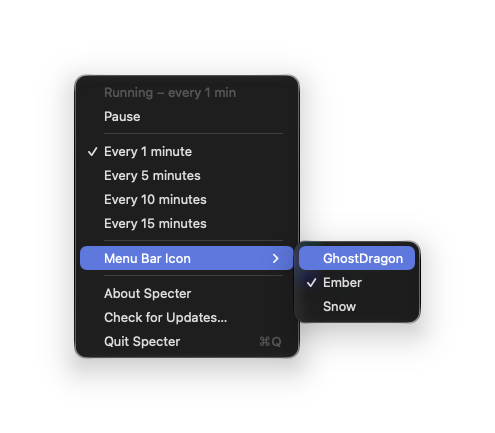
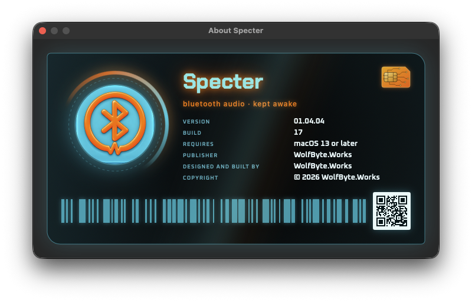

<p align="center">
  
</p>

<h1 align="center">Specter</h1>

<p align="center"><b>Keeps Bluetooth headphones and speakers awake on your Mac.</b></p>

Many Bluetooth speakers and headphones go to sleep after a few minutes of silence, then cut off the start of the next sound or drop the connection. Specter sits in the menu bar and plays one second of silence every few minutes so they stay connected and ready. You hear nothing, and it uses next to no power.

<p align="center">
  
</p>

## Features

- Lives in the menu bar; no Dock icon, no windows in your way.
- Plays a second of silence every 1, 5, 10 or 15 minutes (your choice is remembered).
- Right-click the icon to pause or resume instantly.
- Full-color icon while running, grey while paused:
   running,  paused
- Three icon styles under **Menu Bar Icon** in the menu: **GhostDragon** (above), **Ember**  and **Snow** , which matches the rest of your menu bar (black in a light menu bar).
- Updates itself automatically ([Sparkle](https://sparkle-project.org)).
- VoiceOver reads the icon as "Specter, running" or "Specter, paused", and animations respect Reduce Motion.

## Requirements

- macOS 13 Ventura or later
- A Mac with Apple silicon (M1 or newer)

## Install

1. Download `Specter_v<version>.zip` from the [latest release](../../releases/latest).
2. Unzip it and drag `Specter_v<version>.app` to your Applications folder.
3. Open it. Specter isn't signed with an Apple Developer ID, so the first time macOS will say it can't check it for malicious software:
   - Open **System Settings > Privacy & Security**, scroll down, and click **Open Anyway** next to the message about Specter. Then confirm.
   - Or, in Terminal: `xattr -dr com.apple.quarantine /Applications/Specter_v*.app`
4. The Specter icon appears in your menu bar and it starts running right away.

To start Specter when you log in, add it in **System Settings > General > Login Items**.

## Use

- **Click** the icon for the menu: current state, Pause/Start, the interval, Menu Bar Icon, About, Check for Updates and Quit.
- **Right-click** the icon to pause or resume right away.
- **Menu Bar Icon** picks the icon style: GhostDragon, Ember or Snow. Your choice is saved.
- **Check for Updates…** looks for a newer version now. Specter also checks once a day by itself, downloads updates in the background and installs them when it quits.

<p align="center">
  
</p>

## Privacy

Specter collects nothing and sends nothing about you. The only network traffic is the update check, which downloads `appcast.xml` from this repository's GitHub releases. Each play is written to the macOS system log on your Mac only; to watch it:

```bash
log stream --info --predicate 'subsystem == "works.wolfbyte.Specter"'
```

## Project layout

- `Sources/Specter/main.swift`: menu bar item, timer, playback, updates
- `Sources/Specter/About.swift`: About window
- `Resources/`: the silence MP3, app icon, logo and About-card artwork, and the Chakra Petch / Oxanium fonts
- `Design/`: the full-size logo and color palette
- `docs/images/`: screenshots for this README

## Releasing an update (maintainers)

1. Raise `VERSION` and `BUILD` in `build.sh` and run it.
2. Create the GitHub release `v<version>` and upload the zip and `appcast.xml` from `Specter v<version>/`.

The app reads `releases/latest/download/appcast.xml`, so the newest release is always the update feed. Signing the feed needs the Sparkle private key. It's stored only in locked form (`Signing/sparkle-key.locked`, never in Keychain) and `build.sh` unlocks it with `scripts/sparkle-key.py`, which asks the Bitwarden SSH agent to sign with the "Specter Sparkle" key. So Bitwarden must be unlocked with its SSH agent turned on; nothing is copied or typed. Without the Specter Sparkle key, updates can't be published.

## License

The code and the silence file are under the MIT License (see [LICENSE](LICENSE)). The Specter and WolfByte.Works names, logos and artwork (the app icon, `Resources/Logo.png`, `Resources/MenuBarIcon.png`, `Resources/Branding/*.png` and `Design/`) are not covered by it. The fonts are under the SIL Open Font License (see `Resources/Branding/Fonts`), and Sparkle is under its own MIT license, which ships inside the app (`Contents/Resources/Licenses/Sparkle-LICENSE.txt`).

## Changelog

### 01.04.04 (build 17)
- First public release.
